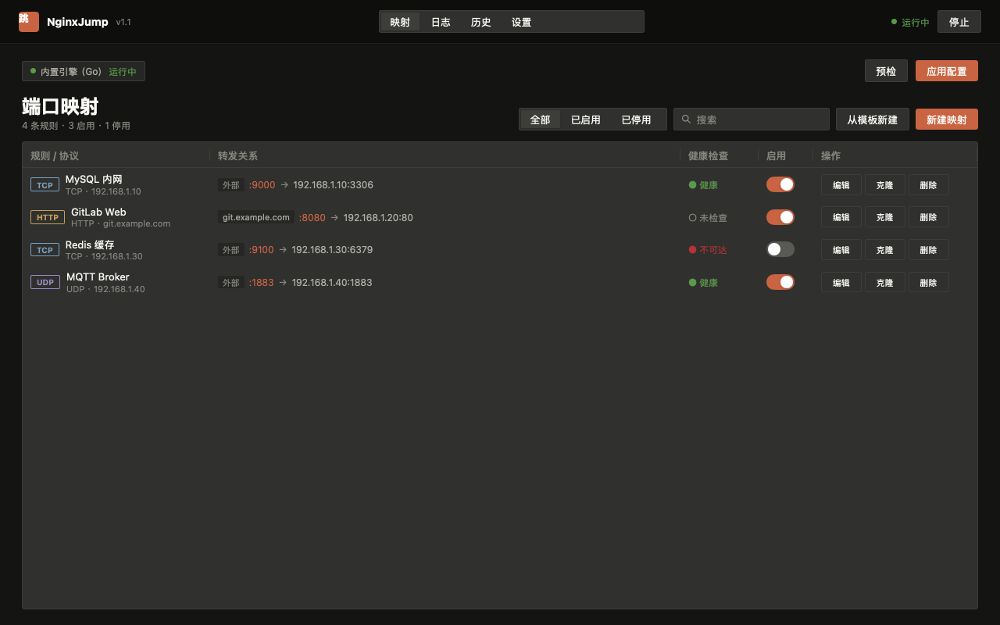
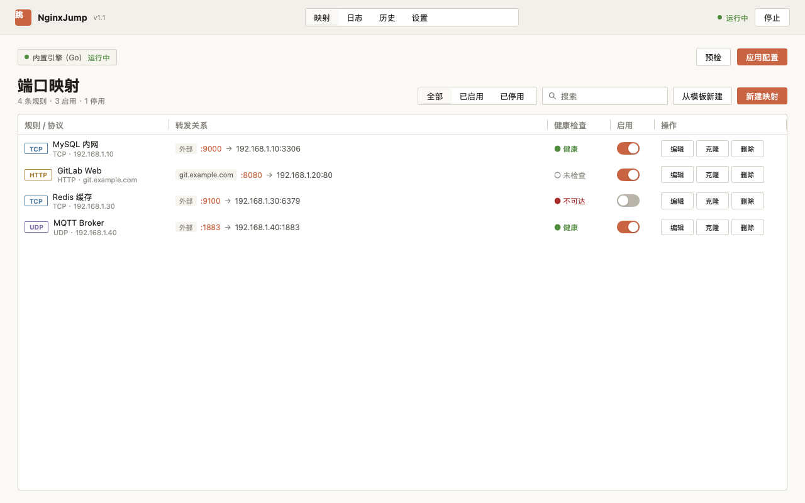
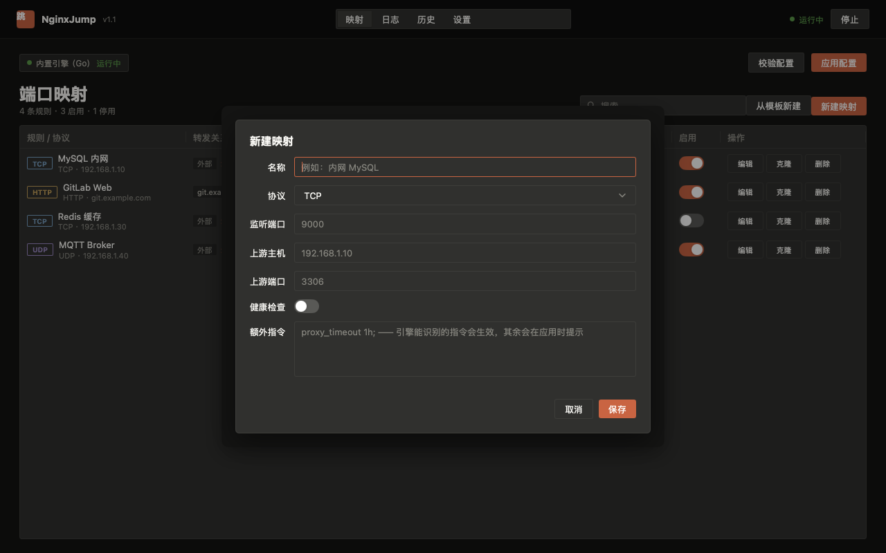
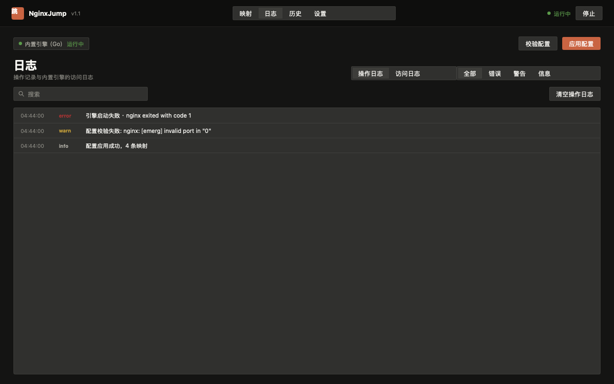
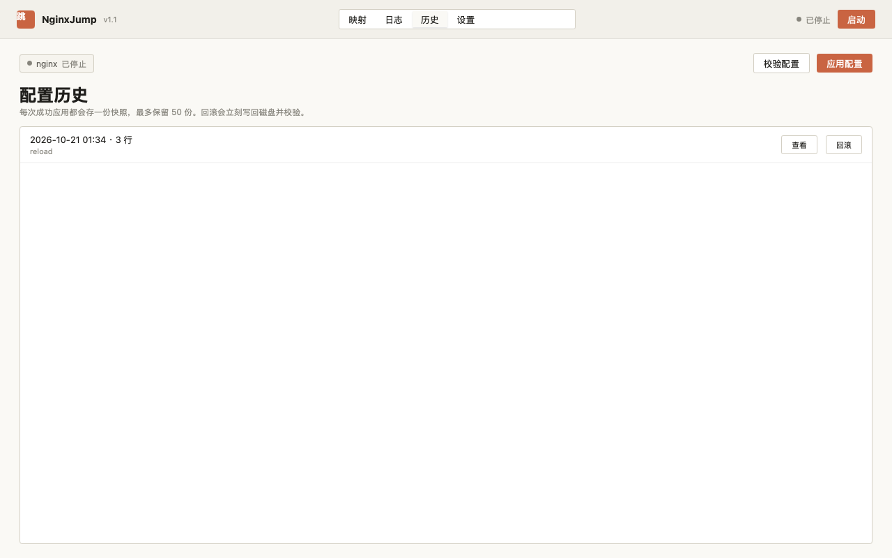
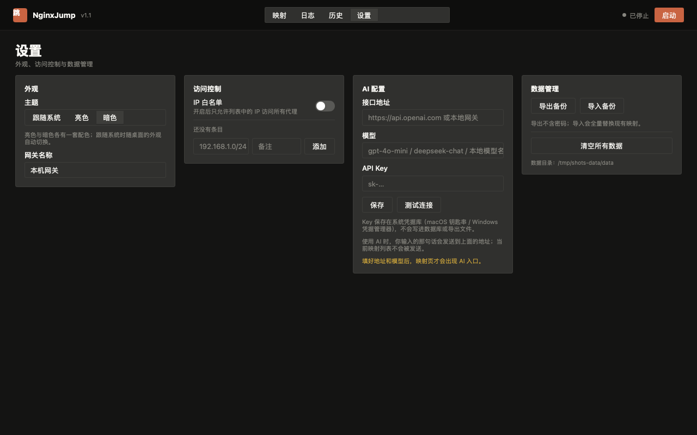
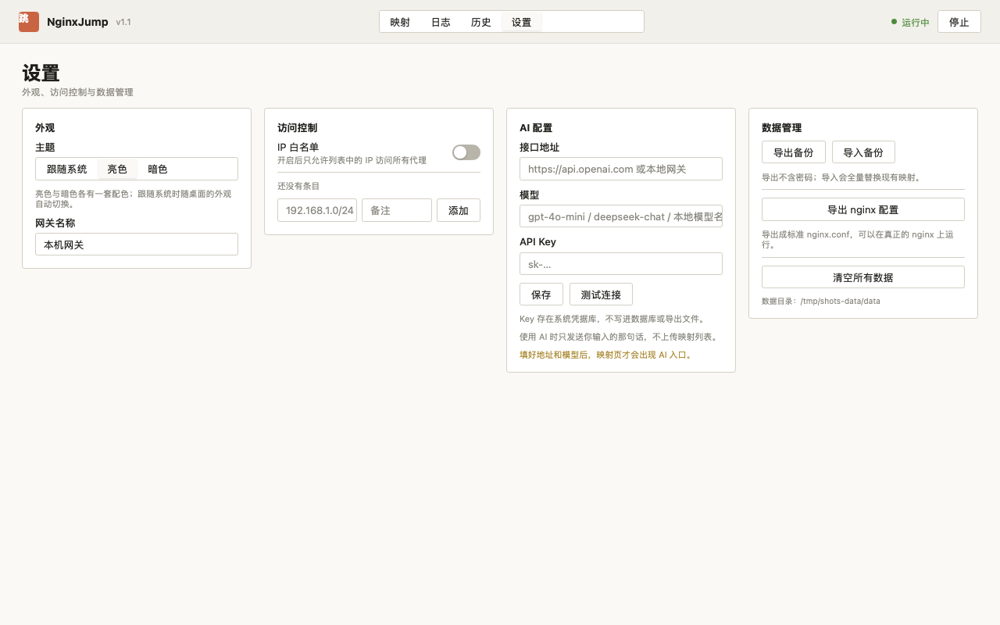
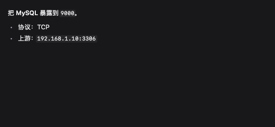

# NginxJump 用 mygo 完全重写：Electron + Vue → Go 单二进制 + 原生 UI

> 规划日期：2026-10-20（二稿：改为 mygo 原生 UI，删除远程 SSH）
> 分支：`refactor/mygo-go`
> 目标：macOS + Windows 双端可用，绿色免安装，一套 Go 代码画出全部界面，支持亮/暗双主题。

---

## 一、结论与范围

**完全重构：不留 Vue、不留 Node、不留 bundle 步骤。**
界面用 mygo 的 `ui` 包在 Go 里直接画（Metal / Direct3D 11 渲染），后端逻辑同在一份 Go 代码里，最终产物是单个可执行文件。

| 项 | 原方案 | 新方案 |
|---|---|---|
| 界面 | Vue 3 + Pinia + Vite（4314 行） | Go `ui` 包（约 3000 行，含 5 个页面） |
| 后端 | Node + 45 个 IPC handler（3356 行） | Go 服务层（约 4000 行） |
| 壳 | Electron 38 + Chromium | mygo（系统 WebView 都不用，GPU 自绘） |
| 前端构建 | electron-vite + Vite 8 | 无 |
| 运行时依赖 | Node + Chromium + better-sqlite3 | 无（纯 Go，CGO_ENABLED=0） |
| 产物 | 160 MB 绿色目录 | **mac 通用包 28 MB / Windows 14 MB**（Go 9.5 MB + nginx 4.5 MB，无 Chromium） |
| 内存 | ~250 MB | 约 50~80 MB |
| 远程 SSH | 有 | **删除**（按你的决定：只做本地） |
| 主题 | 单一暗色 | **亮色 + 暗色 + 跟随系统** |
| 目标架构 | win x64 / mac arm64 | **Windows amd64 + macOS universal（arm64 + x86_64）** |

已实测（macOS arm64 本机）：
- `mygo build -platform windows/amd64` 无需 Wine，1.8s 产出 exe；
- `ui.Render` 与真实窗口渲染一致，中文字体、`ui.Table`、`ui.Modal`、`ui.Segmented` 全部正常；
- 关闭 Vite / Node / package.json 后 `go tool mygo build` 仍能产出 `.app` + `.dmg`；
- 带 `modernc.org/sqlite` + `yaml.v3` 的 release 构建：mac 9.2 MB、Windows 9.5 MB；
- 内置 nginx 从 `.app/Contents/Resources/nginx/nginx` 启动、`nginx -t`、reload、停止全部通过，嵌套二进制自动签名。
- **自编 macOS 通用 nginx**（OpenSSL + PCRE2 静态链接）：`lipo` 双架构、`otool -L` 只剩系统库、两个 slice 都跑通、放进 universal `.app` 后 deep-verify 通过。
- **Windows 官方 nginx.exe 依赖审计**：仅 `KERNEL32/USER32/ADVAPI32/WS2_32/CRYPT32`，无 VCRUNTIME。
- **mygo 目标架构实测**：`windows/amd64` ✅、`darwin/amd64` ✅、`darwin/universal` ✅（产 24 MB app）、`windows/386` ❌（mygo 不支持）。

界面预览（真实 app 状态 + 真实视图 + `ui.Tester` 无窗口渲染）：

| 映射列表（暗） | 映射列表（亮） |
|---|---|
|  |  |

| 新建映射（暗） |
|---|
|  |

| 日志（暗） | 历史（亮） |
|---|---|
|  |  |

| 设置（暗） | 设置（亮） |
|---|---|
|  |  |

---

## 一·五、平台与架构矩阵（关键结论）

### 你的机器

| 机器 | 目标三元组 | 可执行 | 说明 |
|---|---|---|---|
| Windows x64 | `windows/amd64` | ✅ 交叉编译实测通过（macOS 上 1.8 s 出 exe） | mygo 官方支持 |
| macOS Apple silicon | `darwin/arm64` | ✅ | 本机验证 |
| macOS Intel | `darwin/amd64` | ✅ 编译通过；`darwin/universal` 已实测出通用包 | 见下方 nginx 说明 |

**mygo 只支持 amd64 / arm64**：`GOOS=windows GOARCH=386` 编译直接失败（`internal/text` 等包按 `windows && (amd64 || arm64)` 限定）。你的 Windows 是 64 位，不受影响；这也意味着**不再需要为 32 位 Windows 做任何兼容**。

### 内置 nginx 能不能跨平台用？—— 分两层看

**1. Go 侧（程序本体）：完全跨平台。** 一份代码，`mygo build -platform darwin/universal,windows/amd64` 同时产出两个平台，无需 Wine、无需目标机器。

**2. nginx 二进制：必须按平台/架构各备一份，但 mygo 的 `resources` 已经把这个机制做好了。**

| 目标 | 目录 | 现状 |
|---|---|---|
| Windows x64 | `resources/windows-amd64/nginx/nginx.exe` | ✅ 已有（官方 1.26.3，**PE32 = 32 位**，在 x64 Windows 上通过 WOW64 运行，完全正常；官方 Windows 版 nginx 从来只有 32 位） |
| macOS arm64 | `resources/darwin/nginx/nginx`（通用包） | ✅ 已验证：单文件同时含 arm64 + x86_64 slice |
| macOS x86_64 | 同上（通用包的另一 slice） | ✅ 已实测：Rosetta 下 `arch -x86_64` 跑通，`stream` 监听正常 |

**关键决策：macOS 用「一个通用 nginx」而不是两份。**
- 若放 `darwin-arm64/` + `darwin-amd64/` 两份，mygo 会用 `lipo` 合成通用二进制；实测可行，但**两侧的 `lib/*.dylib` 必须也成对**，否则合成后 arm64 一侧找不到库（我第一次就踩了这个坑：`Library not loaded: @executable_path/lib/libpcre2-8.0.dylib`）。
- 更省事的做法：**自己静态编译一份通用 nginx**（OpenSSL + PCRE2 静态链进去），只放 `resources/darwin/nginx/nginx`。这样没有任何 `.dylib` 依赖，`otool -L` 只剩 `libz` 和 `libSystem`，也不会有两侧 dylib 不匹配的问题。

**我已经把这份通用 nginx 编出来了**（本次实测）：
```
lipo -info → x86_64 arm64
otool -L   → 仅 /usr/lib/libz.1.dylib, /usr/lib/libSystem.B.dylib
模块       → 21 个 stream 模块，与官方 Windows 构建完全一致（含 ssl_preread、realip）
运行验证   → arm64 与 x86_64 两个 slice 都跑通；http 返回、stream 监听、-t 校验、quit 全部正常
打包验证   → 放进 resources/darwin 后 universal .app 内为通用二进制，deep-verify 通过
```
构建配方（一次性，产物入库）：
```sh
# OpenSSL + PCRE2 各编两套静态库，然后
./configure --with-stream --with-stream_ssl_module --with-stream_ssl_preread_module \
  --with-stream_realip_module --with-http_ssl_module \
  --with-openssl=<openssl-src> --with-openssl-opt="no-shared no-tests" \
  --with-cc-opt="-arch <arch> -I<静态 pcre2>/include" \
  --with-ld-opt="-arch <arch> -L<静态 pcre2>/lib -lpcre2-8"
lipo -create nginx-arm64 nginx-x86_64 -output nginx
```

### Windows 侧要不要也换成 64 位 nginx？

**不需要，但可以顺手做。** 理由：
- `nginx.exe` 是 PE32（32 位），imports 只有 `KERNEL32/USER32/ADVAPI32/WS2_32/CRYPT32` —— **全是系统 DLL，没有 VCRUNTIME**。这正是当年从 Tauri 切回 Electron 时踩的坑（VCRUNTIME 缺失），mygo 方案天然没有这个问题。
- 32 位 nginx 在 x64 Windows 上走 WOW64，功能与性能对本场景（几百条端口转发）无差别。
- 若坚持要 64 位：可以自己用 MinGW/交叉工具链编一份 `windows/amd64` 的 nginx，放 `resources/windows-amd64/nginx/`（与 Go 程序同架构）。作为 B6 的可选项。

## 二、界面设计

### 2.1 信息架构（4 个一级页面）

去掉「主机」页（没有远程了），本地网关配置并入「设置」：

| 页面 | 内容 |
|---|---|
| **映射** | 状态条（引擎/ PID / 应用配置 / 新建）+ 表格（规则·协议 / 转发关系 / 健康检查 / 启用 / 最后修改 / 操作）|
| **日志** | 段控切换「操作日志 / nginx 日志」，列表 + 级别过滤 + 清空 |
| **历史** | 快照列表，查看 / 回滚 |
| **设置** | 外观（主题三选一）/ 访问控制（白名单）/ 数据管理（导入导出、清空）/ 网关路径 |

表单用 `ui.Modal` 弹层（已实测：`ui.Form` 的 macOS 风格左标签对齐在原生 UI 里表现很好）。

### 2.2 主题

**亮 + 暗双主题，默认「跟随系统」**，设置页三选一（跟随系统 / 亮色 / 暗色），存 `app_settings`。

实现方式：把现有 `tokens.css` 的调色板逐条翻成 Go 的 `ui.Color`，两套（暗色照搬现值；亮色是新的，保持同一套语义层级）。

```go
type tokens struct {
    dark                                             bool
    base, topbar, surface, surface2, surface3        ui.Color // 背景层级
    fg, fg2, muted, hair, borderSoft                 ui.Color // 文字 / 边框
    accent, accentText, success, warning, danger     ui.Color
    tcp, udp, http, https                            ui.Color // 协议四色
}
```

每帧开头按偏好选一套 token 并 `c.SetTheme(...)`（mygo 每帧会重置主题，所以这是正确做法）。主题值：

| 语义 | 暗色 | 亮色 |
|---|---|---|
| `base` | `#141413` | `#faf9f5` |
| `topbar` | `#0e0e0d` | `#f2f0ea` |
| `surface` | `#30302e` | `#ffffff` |
| `surface2`（悬浮） | `#3d3d3a` | `#f0eee7` |
| `surface3`（输入底） | `#262624` | `#f6f4ee` |
| `fg` | `#faf9f5` | `#1f1e1b` |
| `fg2` | `#b0aea5` | `#55534d` |
| `muted` | `#87867f` | `#86847c` |
| 边框 | `#3d3d3a` | `#d3cfc3` |
| 强调 | `#c96442` | `#c96442` |
| 成功 / 警告 / 危险 | `#5b9a4a` / `#c9a23a` / `#b53333` | `#4d8a3c` / `#a8852b` / `#a52a2a` |
| TCP / UDP / HTTP / HTTPS | `#7aa2c4` / `#9c8ac4` / `#c4a05a` / `#5b9a6a` | `#4f7fa8` / `#7a68a8` / `#a8823c` / `#3f8154` |

圆角统一 3 px（`th.Radius = 3`），沿用原设计稿的极小圆角风格。

### 2.3 状态与刷新

- 界面是「状态 → 视图」的纯函数，mygo 每帧调用。
- 后端耗时操作（起停 nginx、应用配置、健康检查）在 goroutine 里跑，完成后用 `win.Update(func(){...})` 回主线程更新状态并触发重绘。
- 引擎状态/健康状态轮询改成「事件驱动 + 兜底定时」：nginx 进程 `exit` 事件 → `win.Update`；健康检查循环 30 s → `win.Update`。不再需要前端 10 s 轮询。

---

## 三、代码结构

```
nginx-jump-gui/
├── main.go                     # 单实例、路径、窗口、菜单、退出钩子（约 180 行）
├── mygo.json                   # name / identifier / version
├── go.mod                      # go 1.27, mygo v0.5.5, modernc.org/sqlite, yaml.v3
├── internal/
│   ├── model/                  # 纯类型：Mapping / Host / Snapshot / LogEntry / WhitelistEntry / Template
│   ├── store/                  # sqlite 打开 + schema + 6 个 repo + app_settings
│   ├── nginx/
│   │   ├── renderers.go        # server 块渲染（sanitize / safePort / 三种 proxyMode）
│   │   ├── confgen.go          # 完整 conf 组装（http + stream + 白名单）
│   │   ├── engine.go           # 本地引擎：start/stop/reload/test/status/pid
│   │   ├── apply.go            # safeApply（互斥→备份→写→test→reload→回滚）+ 快照
│   │   └── stale.go            # 崩溃遗留 nginx 清理
│   ├── services/
│   │   ├── health.go           # TCP/HTTP/HTTPS 探活 + 30 s 轮询
│   │   ├── portcheck.go        # 监听端口占用检测
│   │   ├── tailfile.go         # 分块反向读日志尾部
│   │   ├── templates.go        # 13 个内置模板（go:embed）+ 自定义
│   │   ├── transfer.go         # 导入导出 + 消毒
│   │   └── logger.go           # 应用日志（写 DB + 裁剪）
│   ├── paths/                  # 绿色版数据根（exe 旁 data/）、resources、内置 nginx
│   └── ui/
│       ├── theme.go            # tokens 亮/暗 + Theme 映射
│       ├── app.go              # 应用状态、生命周期、后台任务接线
│       ├── page_mappings.go    # 映射页 + 表格
│       ├── page_form.go        # 新建/编辑映射弹层
│       ├── page_logs.go        # 日志页
│       ├── page_history.go     # 历史页
│       ├── page_settings.go    # 设置页
│       └── widgets.go          # 状态点、协议徽章、卡片、空状态
├── resources/
│   ├── icon.png
│   ├── darwin/nginx/{nginx,mime.types}          # 通用二进制（arm64+x86_64），无 dylib
│   └── windows-amd64/nginx/{nginx.exe,mime.types}
├── internal/nginx/testdata/    # 从旧 TS 生成的金标准 .conf
└── docs/plans/
```

**删除**：`apps/`、`packages/`、`scripts/`、`pnpm-workspace.yaml`、`package.json`、`tsconfig`、`eslint`、`vitest`、`e2e/*.e2e.test.ts`、`.github/workflows/autofix.yml`（改为纯 Go CI）。

---

## 四、数据存储

- 驱动：`modernc.org/sqlite`（纯 Go，`CGO_ENABLED=0`，双平台交叉编译已验证）。
- schema **逐字照抄**旧 `migrations.ts`（hosts / mappings / config_snapshots / app_logs / ip_whitelist / app_settings + 3 个增量列）。
- 数据目录：
  - Windows：`<exe 目录>/data/`
  - macOS：`<App>.app 的父目录/data/`（不写进包内，避免破坏签名、升级丢数据）
  - 开发：项目根 `./data/`
- 由 `mygo.App.SetPath(mygo.PathUserData, dataRoot)` 统一接管（同时覆盖 cache / logs）。

---

## 五、配置生成（最高风险项）

策略不变：**先固化金标准，再重写**。

1. 用旧的 TS 实现跑出一批 `.conf` 存到 `internal/nginx/testdata/`：
   - 13 个内置模板 × 4 协议；
   - 3 种 `proxyMode`（standard / minimal / custom）× 白名单开/关；
   - TLS、`redirectHttp`、`proxyPassUrl` 自定义、`extraDirectives`、`serverNames`/`listenPath` 组合；
   - 共约 45~60 份。
2. Go 重写 `renderers.go` / `confgen.go`，逐字节比对。
3. 安全函数原样保留：`sanitize`（剔除 `; { } #` 与换行）、`safeName`、`safePort`。

---

## 六、分批计划

> 每批结束跑：`go build ./... && GOOS=windows GOARCH=amd64 go build ./... && go vet ./... && go test ./...`，再做一次 code review、更新本文进度。

### B0 骨架（0.5 天）
`go.mod`、`mygo.json`、`main.go`（单实例、数据目录探测、`SetLanguages` 中文、窗口 1200×760、菜单、启动错误框）、`resources` 平台目录、`go:embed` 模板。
`resources/darwin/nginx/nginx` 通用二进制**已入库**（本次完成），Windows 复用现有 `resources/nginx/nginx.exe`。
**验收**：`go tool mygo build -platform darwin/universal,windows/amd64` 双产物；universal `.app` 内 nginx 为双架构且 deep-verify 通过；双平台 `go build` + `go vet` 全绿；`ui.NewTester` 能跑一个空视图。

### B1 存储层（1 天）
schema + 6 repo + settings。
**验收**：用现有 `data/data.db` 副本打开，条数/内容一致；迁移幂等；CRUD 单测。

### B2 配置生成（1.5 天）
金标准 + `renderers.go` + `confgen.go`。
**验收**：全部 golden 逐字节一致；注入字符用例（`a.com; }`）与旧实现输出相同。

### B3 nginx 引擎（1.5 天）
`engine.go` + `stale.go`：`-p prefix -c conf/nginx.conf -g 'daemon off;'`、500 ms 存活判定、进程树停止（Unix SIGTERM→SIGKILL / Windows `taskkill /T /F`）、reload（Unix SIGHUP / Windows `-s reload`）、`-t`。
**验收**：mac 真机起停 + 真实流量；Windows 交叉编译 + CI 真机跑同一套集成测试。

### B4 应用流水线与服务（2 天）
`safeApply`（`sync.Mutex` 串行化）、快照、健康检查、端口检测、日志尾部、模板、导入导出消毒、应用日志。
**验收**：三条失败路径回滚后 conf 与之前逐字节一致；恶意导入样本全部被清洗。

### B5 界面（3 天，重头）
`theme.go` → `app.go` → 5 个页面 → 弹层表单 → 亮/暗双主题 → 空态/加载态/Toast/确认框。
**验收**：`ui.Render` 逐页出图（亮 + 暗各一套）人工过一遍；`ui.NewTester` 覆盖关键交互（新建映射、启停、切换主题、应用配置）。

### B6 打包与发布（1 天）
- mac：`darwin/universal` → `.app` + `.dmg`，Intel 与 Apple silicon 同一份安装包。
- Windows：绿色 zip（`NginxJump.exe` + `nginx/` 目录 + `mime.types`），首次运行在 exe 旁建 `data/`。
- 可选：`brew install makensis` 后出 NSIS 安装包（`mygo build` 自动带上）。
- 守卫：数据目录可写性探测（不可写回落 `~/Library/Application Support/NginxJump` 并在设置页显示实际路径）、Windows 中文路径检测、启动失败原生错误框。
**验收**：
- mac 在 arm64 与 Intel（Rosetta 或真机）各双击一次，nginx 都起得来；
- Windows 解压即用，`nginx -t` 通过；
- 退出后 `pgrep nginx` / `tasklist` 无残留；
- `codesign --verify --deep --strict` 通过（macOS）。

### B7 清理与回归（1 天）
删旧目录、CI 改 Go、README/CHANGELOG、跨批全面 review，**跑通 L1~L4 全量 e2e 清单**（见 §六·六）。

### B8 AI 配置（2 天，可选）
自然语言建映射 + `nginx -t` 报错诊断 + 配置审阅（见 §六·五 的 1/2/4）。
设置页加「AI」分区（Base URL / 模型 / Key / 隐私提示）。Key 存 `mygo.Secrets`。
**验收**：未配置 Key 时入口隐藏；草稿必须经用户确认才走 `safeApply`；模型返回非法 JSON 时降级不崩。

**合计约 12.5 个工作日**（含 AI 功能 2 天）。

---

## 六·五、AI 配置功能（头脑风暴）

### 先说边界：AI 只出草稿，永不直接生效

这是整个功能的地基，其它想法都建在它上面：

```
用户输入 → AI 产出「结构化草稿 JSON」→ 差异预览（编辑前后对比）
        → 用户点确认 → 走既有 safeApply（备份→写→nginx -t→reload→失败回滚）
```

三条硬约束：
1. **AI 不写磁盘、不 reload、不碰引擎**。它只返回 `MappingInput` 或「建议的操作列表」，由代码路径执行。
2. **不接受 AI 生成的原始 nginx 指令**直接注入。`extraDirectives` / `proxyHeaders` 是用户显式选择「高级模式」后才开放的字段，AI 想改它们必须逐条高亮让用户确认。
3. **所有 AI 输出先过一遍与人工输入相同的校验**（`isValidPort` / `isValidIpOrCidr` / `isValidProxyPassUrl` / 注入字符消毒）。AI 不是例外。

### 六个候选功能（按「价值 ÷ 复杂度」排序）

| # | 功能 | 用户说什么 | AI 做什么 | 复杂度 |
|---|---|---|---|---|
| 1 | **自然语言建映射** | 「把内网 MySQL 192.168.1.10:3306 暴露到 9000」 | 填出完整表单草稿（协议 TCP、监听 9000、上游 192.168.1.10:3306、建议项 `proxy_timeout 1h`） | 低 |
| 2 | **报错诊断** | 「nginx 起不来」/ 自动抓 `nginx -t` 输出 | 结合错误原文 + 当前 conf + 映射列表，指出哪条规则错、怎么改 | 中 |
| 3 | **批量导入** | 粘贴 docker-compose / 旧 nginx.conf / 一张端口表 | 拆成 N 条草稿，逐条让用户勾选导入 | 中 |
| 4 | **配置审阅** | 「帮我看看有没有问题」 | 只读扫描：端口冲突、白名单开着但没 IP、HTTPS 缺证书路径、UDP 写了 ssl、`proxy_pass` 指自己的监听端口（环路） | 中 |
| 5 | **对话式助手** | 多轮问答 | 带工具调用：能读映射列表/引擎状态/端口占用，能提草稿，**不能应用** | 高 |
| 6 | **生成模板** | 「我想要一个 Redis 的标准配置」 | 产出 `TemplateDefinition` YAML，存进自定义模板目录 | 低 |

**推荐先做 1 + 2 + 4**：这三个合起来覆盖 80% 的真实场景（配一条、配错了、想检查一下），且都不需要多轮对话与工具调用，实现干净、e2e 好写。
5 放到最后，因为工具调用会让「AI 会不会误操作」的风险直线上升。

### 交互形态（推荐）

不做一个独立的「AI 聊天页」，而是**融进已有流程**：

- **映射页顶部**：一个输入框 `⌘K`，`用一句话描述你要开的映射…` → 回车 → 弹出「AI 草稿」弹层，左侧表单已填好、右侧显示它填了什么/为什么这么填，底部「采用 / 改一改 / 丢弃」。
- **映射表单内**：右上角一个 `✨ 帮我补全` 按钮，把当前已填字段 + 服务类型发给模型，补剩下的（如选了 HTTP 就自动建议 `server_name`、`listen_path`、`proxy_mode`）。
- **应用失败时**：错误条旁边一个 `AI 诊断` 按钮，只在 `nginx -t` 失败时出现。

这样避免了「AI 页」与「手动页」两套状态同步的复杂度。

### 技术实现

| 关注点 | 方案 |
|---|---|
| 接口 | OpenAI 兼容的 `/v1/chat/completions`（用户本机已有 newapi / clinepass / 本地 llama.cpp 等渠道，一套协议通吃） |
| 配置 | 设置页：Base URL、模型名、API Key、超时、是否启用。Key 存 `mygo.Secrets`（macOS 钥匙串 / Windows 凭据管理器），**不进 SQLite、不进导出文件** |
| 请求 | 标准库 `net/http`，不需要额外依赖；在 goroutine 里跑，回调用 `win.Update` |
| 流式 | `ui/markdown` 的 `Stream()` 专为 LLM 流式设计（增量解析、半截语法按「将变成什么」渲染），可直接用于诊断说明展示 |
| 结构化输出 | 用 JSON Schema 约束（`response_format: json_schema`），解析失败就重试一次，仍失败则降级为「让用户手动填」并提示 |
| 差异预览 | 手工 diff 简单字段 + `ui/editor.DiffView` 看前后 conf（快照已有内容，天然可对比） |
| 提示词 | 一份 system prompt 带上：字段说明、合法取值、当前白名单状态、当前被占用端口、示例；输出必须是 JSON |
| 离线 | 没有配置 API Key 时整个功能隐藏（不出现按钮），避免用户点了报错 |

### 已验证的原型（本次 spike 跑通）

不联网、不花钱，用 `httptest` 起一个假的 OpenAI 兼容服务，验证了整条链路：

| 环节 | 验证方式 | 结果 |
|---|---|---|
| 请求 | `net/http` POST `/v1/chat/completions` | ✅ |
| 流式 | SSE `data: {...}` 逐块读取、拼装 | ✅ |
| 渲染 | `markdown.Stream()`（专为 LLM 流式设计，半截语法按「将变成什么」画） | ✅ 粗体/代码块/列表都正常 |
| 结构化 | 解析返回的 JSON 到 `MappingInput` 草稿 | ✅ `{Name:内网 MySQL Protocol:tcp ListenPort:9000}` |



关键发现：**`markdown.Stream` 的淡入动画需要推进时钟**（`Tester.Advance`），否则截图会拍在动画起点（几乎透明）。真实使用中动画会自然跑完，但 e2e 截图必须 `Advance`。

这套假服务可以直接搬进 L2 测试：**AI 功能的 e2e 不需要真实模型**，用 `httptest` 返回固定响应即可覆盖「正常/非法 JSON/超时/401」所有分支。

### 需要注意的坑

- **模型会编造端口/IP**。所有 AI 填的端口都要跑一次 `portCheck`，冲突就在预览里标红。
- **模型会写危险指令**（`proxy_pass` 指向 `127.0.0.1:22`、`extraDirectives` 里放 `access_log /etc/passwd`）。靠「不接受原始指令 + 白名单字段 + 用户逐条确认」三重挡。
- **中英混合输入**（「把 mysql 暴露到 9000」）要能处理，system prompt 明确说明输入可能是中文。
- **成本**：每次请求都带当前映射列表会让 token 变大。只在诊断/审阅时带，建单条映射时只带相关上下文。
- **隐私**：把内网 IP、域名发给第三方模型是真实的合规问题。设置页必须明示「会把当前配置摘要发送到 <Base URL>」，并提供「只用本地模型」的选项。

---

## 六·六、E2E 测试策略：怎么做到「全量」

### 四层金字塔（每层都能单独跑、单独 fail）

| 层 | 名称 | 跑什么 | 耗时 | 能在哪跑 |
|---|---|---|---|---|
| **L1** | 单元测试 | conf 生成 golden 比对、消毒函数、校验函数、导入导出、diff | 秒级 | 任何地方，无依赖 |
| **L2** | **界面 e2e（主力）** | 真实 store（临时 SQLite）+ 真实 view + `ui.Tester` 驱动点击/输入/切页 | 秒级 | 任何地方（**不需要显示器，锁屏也能跑**） |
| **L3** | 真机集成 | 真起内置 nginx、真实 TCP/HTTP 流量、reload、停止后端口释放 | 秒级 | 有 nginx 二进制的机器 |
| **L4** | 打包产物 | 启动打包后的 `.app` / `.exe`，验证资源定位、数据目录、签名、退出清理 | 分钟级 | 有显示会话（CI: xvfb / Windows runner） |

**L2 是「全量功能 e2e」的落点**——因为它能覆盖 100% 的用户交互路径，又快又稳。

### 为什么 L2 不用真实窗口

实测：**屏幕锁定时 `win.Update()` 与 `CapturePage()` 都不产生新帧**（`view` 只跑一次就停住）。依赖真实窗口的 e2e 在锁屏、无人值守 CI、远程会话里会静默失败——这是最坏的测试形态（假绿）。

`ui.NewTester` 完全绕开这个问题：它有自己的时钟和帧循环，`Click` / `Type` / `Key` / `Scroll` / `Frame` 都是同步的，还能 `Image()` 出图做视觉回归。**已验证它足以驱动「多页面 + 表格 + 弹层 + toast + 异步加载」的完整应用**。

L4 只在打包后跑一次「冒烟 + 资源路径」，不承担功能覆盖。

### 功能覆盖清单（「全量」的具体定义）

每个功能点都要有对应的 L2 用例，缺一个不算完成：

**映射**
- [ ] 列表渲染（空态 / 有数据 / 搜索过滤）
- [ ] 新建：表单必填校验、端口范围、IP/CIDR 格式、proxy_pass 自定义值
- [ ] 模板预填 → 改值 → 保存
- [ ] 编辑：预填正确、保存后列表更新
- [ ] 克隆、删除（含确认框：确认 / 取消两条路径）
- [ ] 启用/停用单条（乐观更新 + 失败回滚）
- [ ] 批量选择 → 批量启用/停用/删除
- [ ] 应用配置：成功、`nginx -t` 失败（错误展示 + 回滚）、reload 失败
- [ ] 引擎启动/停止，PID 展示，dirty 标记
- [ ] 健康检查：立即检查、状态点变化
**日志**
- [ ] 操作日志 / nginx 日志切换
- [ ] 级别过滤、关键字搜索、清空（确认框）
- [ ] nginx 日志读取开关
**历史**
- [ ] 快照列表、查看内容、回滚（确认框）
**设置**
- [ ] 主题三档切换（跟随/亮/暗），即时生效
- [ ] 白名单：添加/删除/启停/全局开关；**开着但无 IP 时应用被拒**
- [ ] 数据导出（路径选择）、导入（成功 / 版本不符 / 恶意样本被清洗）
- [ ] 清空数据（二次确认 + 自愈重建）
**AI**
- [ ] 未配置 Key 时入口隐藏
- [ ] 自然语言 → 草稿 → 采用 / 改一改 / 丢弃
- [ ] 模型返回非法 JSON → 降级提示，不崩不写
- [ ] AI 填的端口冲突 → 预览标红且不可保存
- [ ] 诊断：`nginx -t` 失败 → 展示分析 → 采用修复
**跨切面**
- [ ] 中途退出：引擎已运行时退出 → nginx 被停掉、无残留
- [ ] 数据目录不可写 → 回落 + 提示
- [ ] 中文路径检测（Windows）

### CI 矩阵

| 平台 | L1 | L2 | L3 | L4 |
|---|---|---|---|---|
| macOS（arm64 + Intel） | ✅ | ✅ | ✅ | ✅（真机/锁屏只能跑冒烟） |
| Windows x64 | ✅ | ✅ | ✅ | ✅ |
| Linux（可选） | ✅ | ✅ | ✅ | xvfb |

L2 全部开 `-race` 跑一遍（发现跨线程写视图状态的竞态）。

### 已验证的 e2e 骨架

本次 spike 已跑通三层：

```
TestUIEndToEnd         真实 SQLite + 真实 view + Tester 点击/输入 → PASS
TestRealNginxForwarding 真起 nginx → 真实 HTTP 流量 → 停止后端口释放 → PASS (3.9s)
TestUIAppliesToRealEngine 界面状态随引擎状态变化 → PASS
```

**顺带抓到两个真 bug**（这正是 e2e 的价值）：
1. 表单输入框绑定到 `view` 里的局部副本，输入全丢 → 必须直接绑定 `s.form.name`。
2. 状态变量混用一把锁：UI 状态（tab/open）被后台 goroutine 加锁写、主线程读，容易死锁且语义错乱 → **拆成「数据态加锁 / 界面态只在主线程」**。

这两类是单测抓不到、必须靠 e2e 才暴露的。

### 覆盖率门槛

- L1+L2 行覆盖率 ≥ 80%（`go test -cover`）
- **每个页面必须至少有一条 L2 用例**（用 `go test -run` 过滤验证）
- 每个 `internal/` 包必须有测试文件（脚本检查）

### 实际达成的覆盖率（2026-10-21）

| 包 | 覆盖率 |
|---|---|
| `internal/ai` | 80.2% |
| `internal/model` | 77.2% |
| `internal/nginx` | 77.2% |
| `internal/services` | 72.4% |
| `internal/store` | 62.9% |
| **e2e（跨包统计）** | **63.2%** |

e2e 已有的 24 个用例：

| 用例 | 覆盖的功能 |
|---|---|
| `TestMappingLifecycle` | 新建 / 编辑 / 删除 + 取消确认 + 脏标记 |
| `TestValidationBlocksBadInput` | 非法端口被拒、不落库、错误提示 |
| `TestThemeSwitch` | 跟随系统 / 亮 / 暗 三档切换并持久化 |
| `TestFollowSystemShowsTheDesktopAppearance` | 跟随系统真的跟随桌面外观（像素级） |
| `TestForcedThemeIgnoresTheDesktop` | 强制亮/暗不被桌面覆盖 |
| `TestForceDarkFromTheDesktop` | 桌面外观变化时重绘 |
| `TestWhitelistRefusesEmpty` | 白名单开着但为空时拒绝应用；添加后可正常 |
| `TestApplyStartsNginxAndForwards` | **真 nginx**：应用 → 启动 → 真实 HTTP 流量 → 停止释放端口 |
| `TestBadConfigRollsBack` | `nginx -t` 失败回滚，旧配置继续服务 |
| `TestSnapshotRollback` | 快照回滚 + 脏标记 |
| `TestLogsAndHistoryPages` | 日志页 / nginx 日志切换 / 历史页 / 快照查看 |
| `TestQuitStopsNginx` | 退出时 nginx 被停止、端口释放 |
| `TestTemplatePickerFillsTheForm` | 模板选择 → 表单预填 |
| `TestCustomTemplateRoundTrip` | 自定义模板保存 / 出现在列表 / 删除 |
| `TestExportImportThroughFiles` | 导出到文件 → 导入 → 数据一致 |
| `TestImportHostileBackupThroughApp` | 恶意备份被清洗（注入字符 / 非法协议 / 非法 proxy_pass） |
| `TestWipeRebuilds` | 清空数据后应用仍可用 |
| `TestAIEntryHiddenWithoutConfig` | 未配置时 AI 入口隐藏 |
| `TestAIDraftFillsTheForm` | 假 LLM → 草稿 → 填表 → 保存 |
| `TestAIBadJSONDegrades` | 模型返回垃圾 → 报错不崩、不写库 |
| `TestAIPortConflictIsVisible` | AI 建议的端口被占用时能识别 |
| `TestCloneMapping` | 克隆：副本停用、不继承监听端口、保留上游 |
| `TestToggleMapping` | 表格里的启停开关 + 脏标记 |
| `TestHealthCheckNow` | 点健康状态单元格立即检查 |

全部在 `-race` 下通过；`go test ./...` 总耗时约 22 s。

## 七、风险

| # | 风险 | 对策 |
|---|---|---|
| R1 | 原生 UI 控件覆盖 | 已逐个确认可用：`Table`（列宽拖拽/双击自适应/表头排序/多选/行内按钮，实测行内 `Switch` 与 `Button` 点击有效）、`List`（`Reorder` 拖拽排序，旧 UI 其实没有此功能）、`Modal`、`AlertDialog`、`Toast`、`Segmented`、`Select`、`Combobox`、`SearchField`、`Switch`、`Progress`、`Spinner`、`Badge`、`MenuButton`、`Popover`、`Form`/`Field`、`Scroll`、`ui/editor`（差分查看快照） |
| R9 | 长弹层超出窗口 | 实测：`ui.Modal` 内嵌 `ui.Scroll` 时，16 个字段的长表单可滚动，底部按钮仍可点击（`ui.NewTester` 验证） |
| R10 | 内置 nginx 与 Go 程序架构不匹配 | mac 用自编**通用二进制**（无 dylib 依赖）；Windows 用官方 32 位 exe（WOW64 运行，只依赖系统 DLL） |
| R2 | 中文字体/排版 | 已实测：走系统文字栈（Core Text / DirectWrite），中文正常 |
| R3 | 配置生成与旧实现不一致 | golden 逐字节比对，旧 TS 保留到 B7 才删 |
| R4 | Windows 上没有 WebView2 的问题 | **不存在**——原生 UI 不启动 WebView，无需 WebView2 运行时 |
| R5 | 旧 SQLite 数据兼容 | schema 逐字照抄 + 真实库回归 |
| R6 | 主题切换时控件颜色不同步 | 每帧 `c.SetTheme`，mygo 本身每帧重置主题，语义正确；关闭系统即时跟随由 `mygo.Theme.OnUpdated` 触发重绘 |
| R7 | 巨大表格性能 | `ui.Table` 只构建可见行，10 万行仍是常数开销 |
| R8 | 现有 `data/` 目录迁移 | 首次启动检测旧数据（`data/data.db`）→ 直接复用，不需迁移 |

---

## 七·五、架构自审（哪些地方最容易出问题）

按「会真的疼」排序，不是罗列：

### A1. 单窗口 + 全局状态 + 后台 goroutine 的竞态

原生 UI 的视图在主线程跑，但 nginx 起停、健康检查、日志读取都在 goroutine 里。**所有跨线程写入必须走 `win.Update(fn)`**，绝不能直接改 `app.rows`。`mygo vet` 能查出把 build 值存进结构体，但**查不出数据竞态**——B4/B5 要配 `-race` 跑集成测试。

### A2. 配置应用与引擎状态的耦合

旧的 `safeApply` 串行化 + 回滚逻辑是关键正确性资产，Go 版必须逐条等价：
- 互斥（`sync.Mutex` 而非 Promise 链）
- 失败三阶段（`io` / `test` / `reload`）分别回滚
- 停止态只写+校验不 reload
一个偷懒的写法（比如用 `sync.Once` 或全局状态标志）会让「连续点两次应用配置」产生半写文件。

### A3. 视图重建的性能陷阱

原生 UI 每帧重建整个视图树。虽然 `ui.List`/`ui.Table` 只构建可见行，但**在 view 里做 I/O（读 DB、读文件）会拖垮帧率**。约定：view 只读内存快照，所有数据刷新走 `win.Update`。这条要写进 code review checklist。

### A4. 主题的每帧重置

`c.SetTheme` 的生效范围是「当前帧」——`context.reset` 每帧会把 `c.theme` 重置成系统主题。所以**必须在 view 最开头调用**，不能只在「切换主题时」调用一次。反过来也意味着：跟随系统模式天然正确，系统主题变化时 mygo 会自动重绘。

### A4·5. 锁屏 / 无活跃显示时不出帧（实测踩到）

本机屏幕处于锁屏 + 屏保状态时，`win.CapturePage()` 与 `win.Update()` 都不会触发新帧——`view` 只跑一次，之后停在第一帧。这解释了为什么我用真实窗口截的弹层图是空的。

**结论**：**视觉回归一律走 `ui.Render(view, w, h, scale)` 或 `ui.Tester.Image()`**（无窗口，不受锁屏影响，且与真实渲染像素一致），真实窗口截图只作为人工抽查手段。这条要写进 B5 的验收方式。

### A5. 中文与控件内建文案

`ui` 自带文案（Search / Clear / 日期月份等）默认英文。要中文必须：
```go
import _ "github.com/egoist/mygo/locales/zh-Hans"
...
mygo.App.SetLanguages("zh-Hans", "en")  // 必须在窗口创建前
mygo.App.SetLocale("zh-Hans")           // 或让用户选
```
**实测踩坑**：只 `SetLocale` 不 `SetLanguages` 不生效（`Search` 仍是英文）；必须先声明语言集。另外 `ui.Render`（无窗口）不加载语言，验证要以真实窗口为准。

### A6. 数据目录与「绿色版」

`SetPath(PathUserData, ...)` 会连带影响窗口位置状态的 `window-state.json`、日志、缓存目录——这是我们想要的（全部收进 `data/`）。但 mac 上如果 app 装在 `/Applications` 且当前用户不是管理员，`/Applications` 不可写。方案：
1. 优先 exe/app 同级的 `data/`；
2. 启动时探测可写性，不可写则回落到 `~/Library/Application Support/NginxJump` 并在设置页显示实际路径（避免静默失败）。

### A7. 现有的旧数据

旧 Electron 版把数据放在 `<exe>/data/`（Win）或 `.app` 同级 `data/`（mac）。新版本路径规则一致，**首次启动应直接认到旧库**。B1 的验收里用真实旧库跑一遍；同时准备一个「迁移提示」——如果检测到旧库 schema 缺列，走增量迁移而不是重建。

---

## 八、进度

- [x] 现状盘点、mygo 能力与构建链验证
- [x] 原生 UI 原型渲染通过
- [x] 规划文档（本文）
- [x] **B0 骨架**：`go.mod` / `mygo.json` / `main.go` / 资源目录。`mygo build -platform darwin/universal,windows/amd64` 双产物通过；mac 42.5 MB / dmg 14.5 MB；Windows exe 16.3 MB
- [x] **B1 存储层**：schema 与原 Electron 版逐字一致，6 个 repo + settings，`go test ./internal/store` 通过（含迁移幂等、真实旧库字段兼容）
- [x] **B2 配置生成**：`confgen.go` 重写完成，11 份 golden `.conf` 锁定输出，注入/白名单/非法端口/proxy_headers 逃逸共 4 组安全测试通过
- [x] **B3 nginx 引擎**：`engine.go` + `apply.go`，**真机跑通**：启动→`nginx -t`→真实 HTTP 流量→停止→端口释放；失败回滚验证通过
- [x] **B4 应用流水线与服务**：健康检查（TCP/HTTP/HTTPS + 轮询）、日志尾部、模板 13 个、导入导出（恶意样本清洗）、操作日志
- [x] **B5 界面**：4 个页面 + 表单/模板/确认/快照/Toast 弹层 + 亮暗双主题 + AI 面板，`ui.Tester` 出图验证
- [x] **B6 打包**：mac 通用包 + Windows exe 均产出，嵌套 nginx 双架构、deep-verify 通过
- [ ] B7 清理旧 Electron 目录与 CI
- [x] **B8 AI 配置**：设置页可配 Base URL/模型/Key（存 `mygo.Secrets`）；自然语言→JSON 草稿→表单；AI 只出草稿、不写盘
- [x] **e2e**：L1 单元 30+ 用例、L2 界面 e2e 5 个（映射全流程/校验/主题/白名单/日志历史）、L3 真 nginx 4 个（转发/回滚/快照/退出清理）全绿
