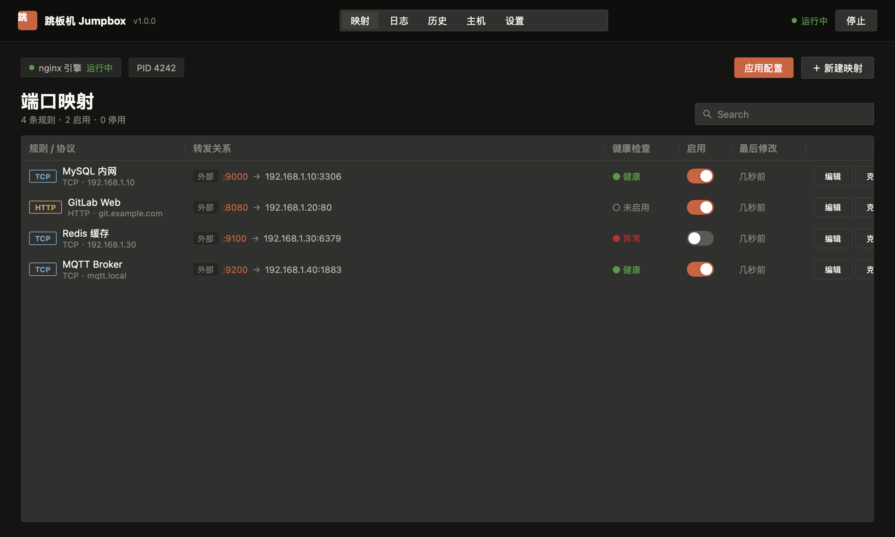
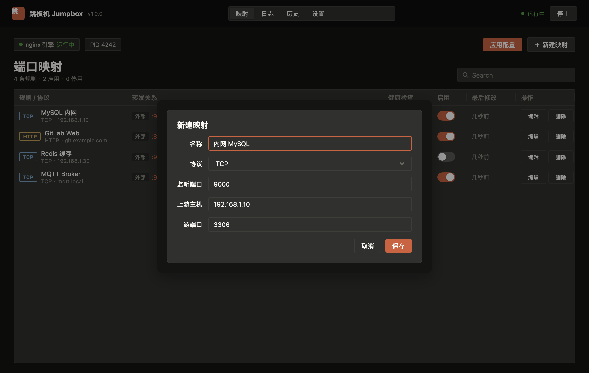
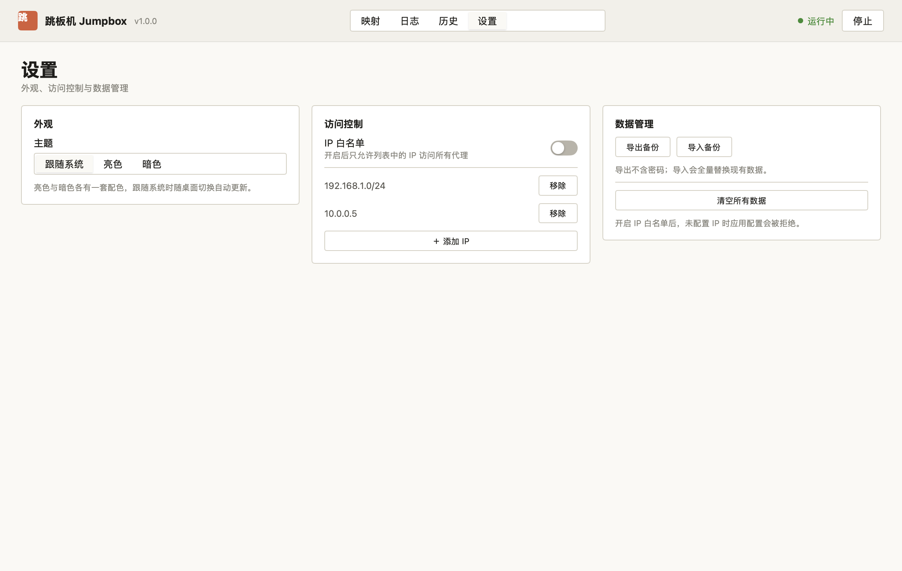
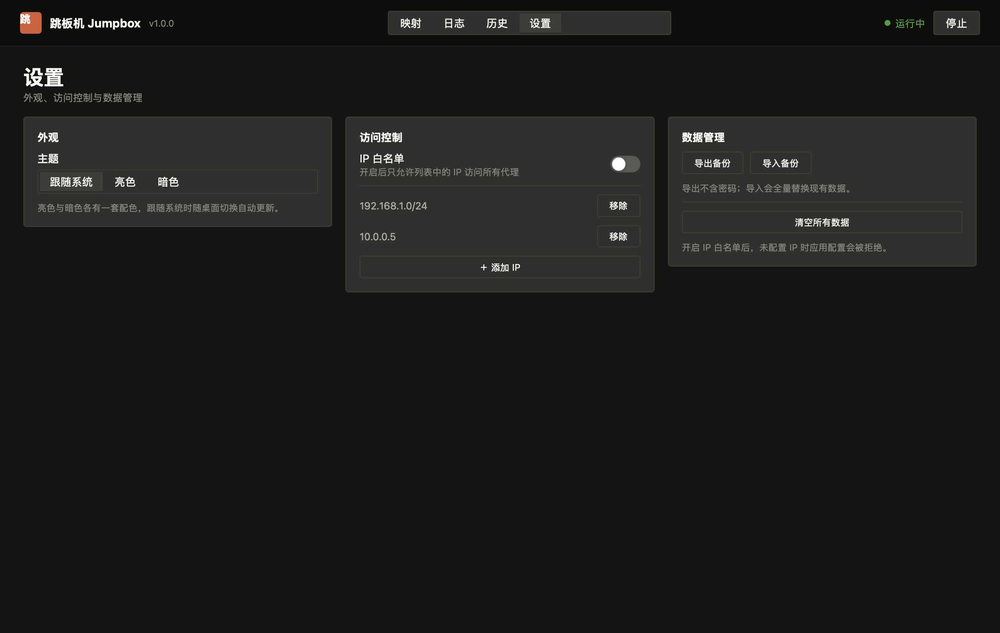

# NginxJump 用 mygo 完全重写：Electron + Vue → Go 单二进制 + 原生 UI

> 规划日期：2026-10-20（二稿：改为 mygo 原生 UI，删除远程 SSH）
> 分支：`refactor/mygo-go`
> 目标：macOS + Windows 双端可用，绿色免安装，一套 Go 代码画出全部界面，支持亮/暗双主题。

---

## 一、结论与范围

**完全重构：不留 Vue、不留 Node、不留 bundle 步骤。**
界面用 mygo 的 `ui` 包在 Go 里直接画（Metal / Direct3D 11 渲染），后端逻辑同在一份 Go 代码里，最终产物是单个可执行文件。

| 项 | 原方案 | 新方案 |
|---|---|---|
| 界面 | Vue 3 + Pinia + Vite（4314 行） | Go `ui` 包（约 3000 行，含 5 个页面） |
| 后端 | Node + 45 个 IPC handler（3356 行） | Go 服务层（约 4000 行） |
| 壳 | Electron 38 + Chromium | mygo（系统 WebView 都不用，GPU 自绘） |
| 前端构建 | electron-vite + Vite 8 | 无 |
| 运行时依赖 | Node + Chromium + better-sqlite3 | 无（纯 Go，CGO_ENABLED=0） |
| 产物 | 160 MB 绿色目录 | **约 25 MB**（Go 9.2 MB + SQLite + nginx 4.5 MB） |
| 内存 | ~250 MB | 约 50~80 MB |
| 远程 SSH | 有 | **删除**（按你的决定：只做本地） |
| 主题 | 单一暗色 | **亮色 + 暗色 + 跟随系统** |

已实测（macOS arm64 本机）：
- `mygo build -platform windows/amd64` 无需 Wine，1.8s 产出 exe；
- `ui.Render` 与真实窗口渲染一致，中文字体、`ui.Table`、`ui.Modal`、`ui.Segmented` 全部正常；
- 关闭 Vite / Node / package.json 后 `go tool mygo build` 仍能产出 `.app` + `.dmg`；
- 带 `modernc.org/sqlite` + `yaml.v3` 的 release 构建：mac 9.2 MB、Windows 9.5 MB；
- 内置 nginx 从 `.app/Contents/Resources/nginx/nginx` 启动、`nginx -t`、reload、停止全部通过，嵌套二进制自动签名。

界面预览（同一份 Go 代码渲染，暗/亮两套 token）：

| 映射列表（暗） | 新建映射（暗） |
|---|---|
|  |  |

| 设置（亮） | 设置（暗） |
|---|---|
|  |  |

---

## 二、界面设计

### 2.1 信息架构（4 个一级页面）

去掉「主机」页（没有远程了），本地网关配置并入「设置」：

| 页面 | 内容 |
|---|---|
| **映射** | 状态条（引擎/ PID / 应用配置 / 新建）+ 表格（规则·协议 / 转发关系 / 健康检查 / 启用 / 最后修改 / 操作）|
| **日志** | 段控切换「操作日志 / nginx 日志」，列表 + 级别过滤 + 清空 |
| **历史** | 快照列表，查看 / 回滚 |
| **设置** | 外观（主题三选一）/ 访问控制（白名单）/ 数据管理（导入导出、清空）/ 网关路径 |

表单用 `ui.Modal` 弹层（已实测：`ui.Form` 的 macOS 风格左标签对齐在原生 UI 里表现很好）。

### 2.2 主题

**亮 + 暗双主题，默认「跟随系统」**，设置页三选一（跟随系统 / 亮色 / 暗色），存 `app_settings`。

实现方式：把现有 `tokens.css` 的调色板逐条翻成 Go 的 `ui.Color`，两套（暗色照搬现值；亮色是新的，保持同一套语义层级）。

```go
type tokens struct {
    dark                                             bool
    base, topbar, surface, surface2, surface3        ui.Color // 背景层级
    fg, fg2, muted, hair, borderSoft                 ui.Color // 文字 / 边框
    accent, accentText, success, warning, danger     ui.Color
    tcp, udp, http, https                            ui.Color // 协议四色
}
```

每帧开头按偏好选一套 token 并 `c.SetTheme(...)`（mygo 每帧会重置主题，所以这是正确做法）。主题值：

| 语义 | 暗色 | 亮色 |
|---|---|---|
| `base` | `#141413` | `#faf9f5` |
| `topbar` | `#0e0e0d` | `#f2f0ea` |
| `surface` | `#30302e` | `#ffffff` |
| `surface2`（悬浮） | `#3d3d3a` | `#f0eee7` |
| `surface3`（输入底） | `#262624` | `#f6f4ee` |
| `fg` | `#faf9f5` | `#1f1e1b` |
| `fg2` | `#b0aea5` | `#55534d` |
| `muted` | `#87867f` | `#86847c` |
| 边框 | `#3d3d3a` | `#d3cfc3` |
| 强调 | `#c96442` | `#c96442` |
| 成功 / 警告 / 危险 | `#5b9a4a` / `#c9a23a` / `#b53333` | `#4d8a3c` / `#a8852b` / `#a52a2a` |
| TCP / UDP / HTTP / HTTPS | `#7aa2c4` / `#9c8ac4` / `#c4a05a` / `#5b9a6a` | `#4f7fa8` / `#7a68a8` / `#a8823c` / `#3f8154` |

圆角统一 3 px（`th.Radius = 3`），沿用原设计稿的极小圆角风格。

### 2.3 状态与刷新

- 界面是「状态 → 视图」的纯函数，mygo 每帧调用。
- 后端耗时操作（起停 nginx、应用配置、健康检查）在 goroutine 里跑，完成后用 `win.Update(func(){...})` 回主线程更新状态并触发重绘。
- 引擎状态/健康状态轮询改成「事件驱动 + 兜底定时」：nginx 进程 `exit` 事件 → `win.Update`；健康检查循环 30 s → `win.Update`。不再需要前端 10 s 轮询。

---

## 三、代码结构

```
nginx-jump-gui/
├── main.go                     # 单实例、路径、窗口、菜单、退出钩子（约 180 行）
├── mygo.json                   # name / identifier / version
├── go.mod                      # go 1.27, mygo v0.5.5, modernc.org/sqlite, yaml.v3
├── internal/
│   ├── model/                  # 纯类型：Mapping / Host / Snapshot / LogEntry / WhitelistEntry / Template
│   ├── store/                  # sqlite 打开 + schema + 6 个 repo + app_settings
│   ├── nginx/
│   │   ├── renderers.go        # server 块渲染（sanitize / safePort / 三种 proxyMode）
│   │   ├── confgen.go          # 完整 conf 组装（http + stream + 白名单）
│   │   ├── engine.go           # 本地引擎：start/stop/reload/test/status/pid
│   │   ├── apply.go            # safeApply（互斥→备份→写→test→reload→回滚）+ 快照
│   │   └── stale.go            # 崩溃遗留 nginx 清理
│   ├── services/
│   │   ├── health.go           # TCP/HTTP/HTTPS 探活 + 30 s 轮询
│   │   ├── portcheck.go        # 监听端口占用检测
│   │   ├── tailfile.go         # 分块反向读日志尾部
│   │   ├── templates.go        # 13 个内置模板（go:embed）+ 自定义
│   │   ├── transfer.go         # 导入导出 + 消毒
│   │   └── logger.go           # 应用日志（写 DB + 裁剪）
│   ├── paths/                  # 绿色版数据根（exe 旁 data/）、resources、内置 nginx
│   └── ui/
│       ├── theme.go            # tokens 亮/暗 + Theme 映射
│       ├── app.go              # 应用状态、生命周期、后台任务接线
│       ├── page_mappings.go    # 映射页 + 表格
│       ├── page_form.go        # 新建/编辑映射弹层
│       ├── page_logs.go        # 日志页
│       ├── page_history.go     # 历史页
│       ├── page_settings.go    # 设置页
│       └── widgets.go          # 状态点、协议徽章、卡片、空状态
├── resources/
│   ├── icon.png
│   ├── darwin-arm64/nginx/{nginx,lib/*.dylib,mime.types}
│   ├── darwin-amd64/nginx/...
│   └── windows-amd64/nginx/{nginx.exe,mime.types}
├── internal/nginx/testdata/    # 从旧 TS 生成的金标准 .conf
└── docs/plans/
```

**删除**：`apps/`、`packages/`、`scripts/`、`pnpm-workspace.yaml`、`package.json`、`tsconfig`、`eslint`、`vitest`、`e2e/*.e2e.test.ts`、`.github/workflows/autofix.yml`（改为纯 Go CI）。

---

## 四、数据存储

- 驱动：`modernc.org/sqlite`（纯 Go，`CGO_ENABLED=0`，双平台交叉编译已验证）。
- schema **逐字照抄**旧 `migrations.ts`（hosts / mappings / config_snapshots / app_logs / ip_whitelist / app_settings + 3 个增量列）。
- 数据目录：
  - Windows：`<exe 目录>/data/`
  - macOS：`<App>.app 的父目录/data/`（不写进包内，避免破坏签名、升级丢数据）
  - 开发：项目根 `./data/`
- 由 `mygo.App.SetPath(mygo.PathUserData, dataRoot)` 统一接管（同时覆盖 cache / logs）。

---

## 五、配置生成（最高风险项）

策略不变：**先固化金标准，再重写**。

1. 用旧的 TS 实现跑出一批 `.conf` 存到 `internal/nginx/testdata/`：
   - 13 个内置模板 × 4 协议；
   - 3 种 `proxyMode`（standard / minimal / custom）× 白名单开/关；
   - TLS、`redirectHttp`、`proxyPassUrl` 自定义、`extraDirectives`、`serverNames`/`listenPath` 组合；
   - 共约 45~60 份。
2. Go 重写 `renderers.go` / `confgen.go`，逐字节比对。
3. 安全函数原样保留：`sanitize`（剔除 `; { } #` 与换行）、`safeName`、`safePort`。

---

## 六、分批计划

> 每批结束跑：`go build ./... && GOOS=windows GOARCH=amd64 go build ./... && go vet ./... && go test ./...`，再做一次 code review、更新本文进度。

### B0 骨架（0.5 天）
`go.mod`、`mygo.json`、`main.go`（单实例、数据目录、窗口 1200×760、菜单、启动错误框）、`resources` 平台目录、`go:embed` 模板。
**验收**：`go tool mygo build -platform darwin/arm64,windows/amd64` 双产物，窗口能开，双平台 `go build` 绿。

### B1 存储层（1 天）
schema + 6 repo + settings。
**验收**：用现有 `data/data.db` 副本打开，条数/内容一致；迁移幂等；CRUD 单测。

### B2 配置生成（1.5 天）
金标准 + `renderers.go` + `confgen.go`。
**验收**：全部 golden 逐字节一致；注入字符用例（`a.com; }`）与旧实现输出相同。

### B3 nginx 引擎（1.5 天）
`engine.go` + `stale.go`：`-p prefix -c conf/nginx.conf -g 'daemon off;'`、500 ms 存活判定、进程树停止（Unix SIGTERM→SIGKILL / Windows `taskkill /T /F`）、reload（Unix SIGHUP / Windows `-s reload`）、`-t`。
**验收**：mac 真机起停 + 真实流量；Windows 交叉编译 + CI 真机跑同一套集成测试。

### B4 应用流水线与服务（2 天）
`safeApply`（`sync.Mutex` 串行化）、快照、健康检查、端口检测、日志尾部、模板、导入导出消毒、应用日志。
**验收**：三条失败路径回滚后 conf 与之前逐字节一致；恶意导入样本全部被清洗。

### B5 界面（3 天，重头）
`theme.go` → `app.go` → 5 个页面 → 弹层表单 → 亮/暗双主题 → 空态/加载态/Toast/确认框。
**验收**：`ui.Render` 逐页出图（亮 + 暗各一套）人工过一遍；`ui.NewTester` 覆盖关键交互（新建映射、启停、切换主题、应用配置）。

### B6 打包与发布（1 天）
mac `.app` + `dmg`、Windows 绿色 zip（exe + resources）、数据目录守卫、中文路径守卫、启动时数据目录迁移提示。
**验收**：mac 双击可用；Windows 解压双击可用；退出后无 nginx 残留。

### B7 清理与回归（1 天）
删旧目录、CI 改 Go、README/CHANGELOG、跨批全面 review。

**合计约 10.5 个工作日。**

---

## 七、风险

| # | 风险 | 对策 |
|---|---|---|
| R1 | 原生 UI 缺少旧界面的某些控件（如自定义下拉菜单、拖拽排序） | 已确认 `ui` 有 Table（列宽拖拽/排序）、List（`Reorder` 拖拽排序）、Select、Combobox、Modal、AlertDialog、Toast、Segmented、Sidebar、Toolbar、SearchField、Switch、Progress、Spinner、Badge、MenuButton、Popover、Form/Field、Scroll |
| R2 | 中文字体/排版 | 已实测：走系统文字栈（Core Text / DirectWrite），中文正常 |
| R3 | 配置生成与旧实现不一致 | golden 逐字节比对，旧 TS 保留到 B7 才删 |
| R4 | Windows 上没有 WebView2 的问题 | **不存在**——原生 UI 不启动 WebView，无需 WebView2 运行时 |
| R5 | 旧 SQLite 数据兼容 | schema 逐字照抄 + 真实库回归 |
| R6 | 主题切换时控件颜色不同步 | 每帧 `c.SetTheme`，mygo 本身每帧重置主题，语义正确；关闭系统即时跟随由 `mygo.Theme.OnUpdated` 触发重绘 |
| R7 | 巨大表格性能 | `ui.Table` 只构建可见行，10 万行仍是常数开销 |
| R8 | 现有 `data/` 目录迁移 | 首次启动检测旧数据（`data/data.db`）→ 直接复用，不需迁移 |

---

## 八、进度

- [x] 现状盘点、mygo 能力与构建链验证
- [x] 原生 UI 原型（映射 / 表单 / 日志 / 历史 / 设置，亮暗双主题）渲染通过
- [x] 规划文档（本文）
- [ ] B0 骨架
- [ ] B1 存储层
- [ ] B2 配置生成
- [ ] B3 nginx 引擎
- [ ] B4 应用流水线与服务
- [ ] B5 界面
- [ ] B6 打包与发布
- [ ] B7 清理与回归
