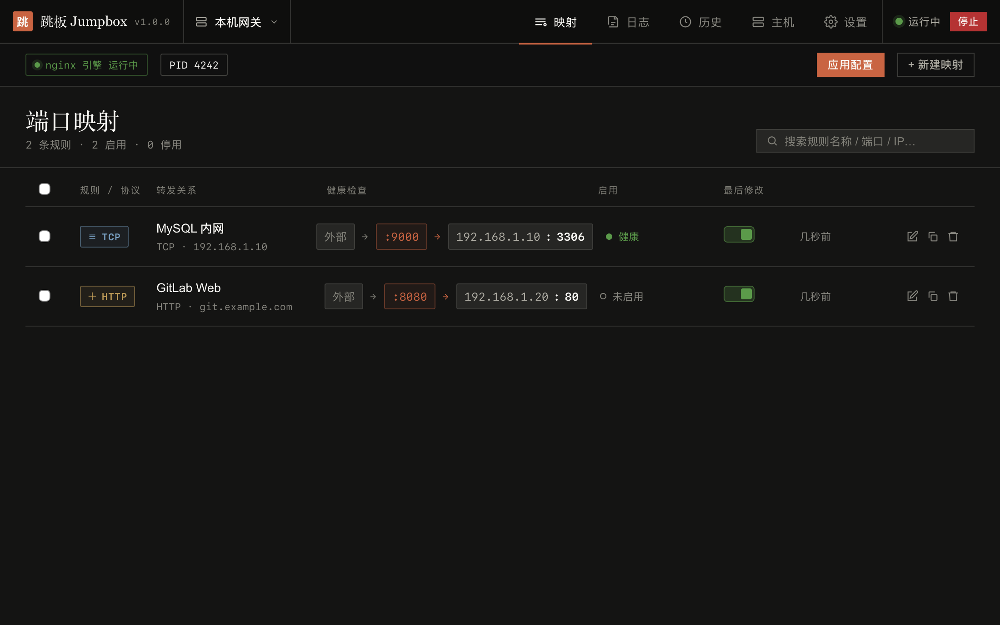

# NginxJump 用 mygo 重构：Electron + Node → Go 单二进制

> 规划日期：2026-10-20 · 分支：`refactor/mygo-go`（已建，从 `feat/electron-ipc@5542ab7` 切出）
> 目标：macOS + Windows 双端可用，绿色免安装，代码量与运行内存大幅下降。

---

## 一、结论先行

**推荐方案：保留 Vue 3 前端，后端（Electron main + Node 业务层）整体换成 Go，用 mygo 做壳。**

- 前端 4300 行 Vue/Pinia 基本不动 —— 已实测：把现有 `apps/desktop/out/renderer` 直接塞进 mygo 窗口，界面与交互完全正常（截图见下）。
- 后端 3356 行 TS 翻成 Go，规模约 4000~4500 行 Go（含测试），逐模块可验证。
- 产物：mac `.app` + `dmg`，Windows `.exe` 绿色目录 + zip，单机交叉编译，无需 Wine、无需目标平台。
- 体积：当前 Electron 绿色版 160 MB → 预计 **25~30 MB**（Go 壳 ~10 MB + SQLite ~8 MB + nginx 4.5 MB）。

**唯一需要你拍板的**：远程 / SSH 主机功能（见 §九 D1）。其余按本文推进。

---

## 二、为什么可行（已实测，不是纸面推演）

| 验证项 | 做法 | 结果 |
|---|---|---|
| mygo 交叉编译 | `mygo build -platform windows/amd64`（macOS arm64 上） | ✅ 5.3s 产出 `NginxJump.exe`，无需 Wine / 无需 Windows |
| mac 打包 | `mygo build -platform darwin/arm64` | ✅ `.app` + `.dmg`，7s |
| 平台资源目录 | `resources/darwin-arm64/nginx`、`resources/windows-amd64/nginx/nginx.exe` | ✅ 各自只带自己那份；可执行位保留 |
| 嵌套二进制签名 | nginx + 3 个 dylib 放进 resources | ✅ 逐一 ad-hoc 签名，`codesign --verify --deep --strict` 通过 |
| 内置 nginx 真实运行 | 从 `.app/Contents/Resources/nginx/nginx` 起，`-p prefix -c conf/nginx.conf -g 'daemon off;'` | ✅ `nginx -t` 通过、端口监听、curl 取到响应、`-s quit` 后端口释放 |
| 现有 Vue 前端 | 把 Electron 构建产物 embed 进 mygo 窗口，preload 注入假 `electronAPI` | ✅ 5 个页面渲染正常、45 个"IPC"调用路径全部命中（见 §八 证据图） |
| 纯 Go SQLite | `modernc.org/sqlite`，`CGO_ENABLED=0` | ✅ mac + windows/amd64 都能交叉编译，二进制 ~9.6 MB |
| 类型化 IPC 生成 | `mygo generate` 解析 struct tag / 变参 / 枚举 | ✅ 生成 `id` `number | null`、`Status = "running" | "stopped"`、`...args: unknown[]` |
| 关键 API 齐全 | `Bind` `NewEvent` `SetFrontend` `SetPath` `Secrets` `Tray` `Dialog` `RequestSingleInstanceLock` `OnBeforeQuit` `OnWillDownload` | ✅ 在 v0.5.5 模块缓存中逐个 grep 确认 |

---

## 三、技术映射表（逐项对位）

| 现在（Electron） | 重构后（mygo + Go） | 备注 |
|---|---|---|
| Electron 38 主进程 | Go `main.go` + `mygo.App.Run()` | 无 Chromium、无 Node |
| BrowserWindow / WKWebView | 系统 WebView（WKWebView / WebView2） | Windows 需要 WebView2 运行时，见 §七 R1 |
| preload + contextBridge | mygo 注入的 `window.mygo` + 生成的 `src/mygo.ts` | 不再手写 preload |
| 45 个 `ipcMain.handle` | 9 个 Go 服务（Bind）+ 1 个兼容 dispatcher | 见 §五 |
| `electron-vite` 三进程构建 | `mygo build`（前端 Vite 8 + Go 编译 + 打包） | 一套命令出三平台产物 |
| `node:sqlite` | `modernc.org/sqlite`（database/sql） | 纯 Go，schema 完全不变 |
| `fs-extra` | `os` / `path/filepath` | |
| `ssh2` | `golang.org/x/crypto/ssh`（若保留远程） | 见 D1 |
| `yaml` | `gopkg.in/yaml.v3` | 模板解析 |
| `safeStorage`（OS 钥匙串） | `mygo.Secrets` 或本地 AES-GCM 密钥文件 | 见 §七 R4 |
| `child_process.spawn` nginx | `os/exec` + `Setpgid`（Unix）/ `taskkill /T /F`（Win） | 已用 spike 验证进程树清理 |
| `electron-builder` + 自写 `build-desktop.mjs` | `mygo build` + 一个 zip 脚本 | 少 ~500 行打包代码 |
| Playwright Electron e2e | Go 集成测试（真起 nginx + curl）+ 前端 vitest | |

---

## 四、新架构与目录

```
nginx-jump-gui/
├── main.go                     # 单实例、路径、窗口、菜单、退出钩子
├── mygo.config.ts              # name/identifier/version/frontendDist/resources
├── go.mod                      # go 1.27, mygo v0.5.5, modernc.org/sqlite, yaml.v3
├── frontend/                   # 原 apps/desktop/src/renderer，Vite 8 + Vue 3
│   ├── src/{api,components,stores,styles,utils,mygo.ts}
│   ├── index.html  vite.config.ts  package.json  tsconfig.json
├── internal/
│   ├── paths/                  # 绿色版数据根（exe 旁 data/）、resources、bundled nginx
│   ├── store/                  # 连接、迁移、repos（host/mapping/snapshot/log/whitelist/settings）
│   ├── nginx/                  # engine.go（local）、confgen、renderers、apply、snapshot、stale
│   ├── services/               # healthcheck（含定时循环）、portcheck、tailfile、transfer、templates
│   ├── logx/                   # 应用日志（写 DB + 裁剪）
│   └── api/                    # 对外服务 + legacy dispatcher
├── resources/
│   ├── icon.png                # 1024×1024
│   ├── darwin-arm64/nginx/{nginx,lib/*.dylib,mime.types}
│   ├── darwin-amd64/nginx/...
│   └── windows-amd64/nginx/{nginx.exe,mime.types}
├── testdata/conf/              # golden 配置样例（由旧 TS 生成）
└── e2e/                        # 真 nginx 集成测试
```

数据目录（绿色版语义，与原实现一致）：

| 平台 | 数据根 |
|---|---|
| Windows 绿色版 | `<exe 所在目录>/data/` |
| macOS | `<App>.app 的父目录/data/`（不写进 .app，避免破坏签名 + 升级丢数据） |
| 开发（`go run` / `mygo dev`） | 项目根 `./data/` |

实现：`mygo.App.SetPath(mygo.PathUserData, dataRoot)`（同时覆盖 PathCache / PathLogs），在 `Run()` 之前设置。

---

## 五、45 个 IPC handler → Go 服务

保留「一个通道一个 handler」的语义，但宿主从 `ipcMain` 换成 Go 服务。分两类入口：

1. **类型化服务**（长期接口，`mygo generate` 生成 TS）：前端逐步迁过来。
2. **兼容 dispatcher**（`Api.Invoke(channel, ...args)`）：把旧的 45 个通道名原样路由，**前端第一版可以零改动跑起来**，降低一次性风险。已实测生成器支持 `Invoke(channel string, args ...any)`。

| 服务 | 覆盖通道 | Go 方法数 |
|---|---|---|
| `Hosts` | host/list\|create\|update\|delete\|set-default\|switch\|test-connection | 7 |
| `Mappings` | mapping/list\|create\|update\|delete | 4 |
| `Engine` | engine/start\|stop\|reload\|test\|status\|dirty-get\|pid-get\|kind-get\|refresh-status | 9 |
| `Templates` | template/list\|list-builtin\|save-custom\|delete-custom | 4 |
| `Logs` | log/list\|clear、nginx-log/tail\|clear\|read-enabled-get\|set | 6 |
| `Snapshots` | snapshot/list\|get\|rollback | 3 |
| `Health` | health/check-now | 1 |
| `Net` | port/check、network/local-ips | 2 |
| `Data` | data/wipe\|export\|import | 3 |
| `Whitelist` | whitelist/list\|add\|remove\|toggle-ip\|get-enabled\|set-enabled | 6 |
| **合计** | | **45** |

每条 handler 里的校验（`isValidPort` / `isValidIpOrCidr` / `isValidProxyPassUrl` 等）原样翻译成 Go 函数，并保留「渲染层可被绕过，后端必须兜底」的设计意图。

---

## 六、分批计划（每批独立可验收）

> 约定：每批结束跑 `go build ./... && GOOS=windows go build ./... && go vet ./... && go test ./...`，再单独 code review；文档同步勾进度。

### B0 骨架与构建链（半天）
- `go.mod` / `mygo.config.ts` / 目录搬迁（renderer → `frontend/`）
- `main.go`：单实例锁、绿色数据目录、主窗口（1100×720）、菜单、启动失败原生错误框
- `resources`：平台目录 + icon + nginx 二进制
- **验收**：`mygo build -platform darwin/arm64,windows/amd64` 双产物；`.app` 打开是空白页不崩；`mygo generate` 产出 `frontend/src/mygo.ts`；双平台 `go build` 全绿。

### B1 存储层（1 天）
- `modernc.org/sqlite` + 与旧 `migrations.ts` **逐字一致**的 schema（含 3 个增量列 `proxy_mode` / `proxy_headers` / `proxy_pass_url`）
- 6 个 repo + `app_settings` 键值
- **验收**：拿现有 `data/data.db` 副本直接打开，hosts/mappings/snapshots/logs 条数与内容一致；迁移幂等（跑两次）；CRUD 单测。

### B2 nginx 引擎与配置生成（最大风险，2 天）
- **先做 golden fixtures**：在旧 vitest 里跑 `renderers` + `confGenerator`，导出 13 个内置模板 × 4 协议 × 白名单开关 × 3 种 proxyMode × proxyPassUrl 共约 60 份 `.conf` 到 `testdata/conf/`
- Go 重写 `renderers` / `confGenerator`（含 `sanitize` / `safeName` / `safePort` / 注入字符剔除，**一字节不差**）
- `engine.go`：`-p prefix -c conf/nginx.conf -g 'daemon off;'`、500ms 存活判定、`exit` 长监听、`stop`（Unix SIGTERM→3s SIGKILL / Win `taskkill /PID /T /F`）、`reload`（Unix SIGHUP / Win `-s reload`）、`test`
- `stale.go`：按 `logs/nginx.pid` 清理上次崩溃遗留
- **验收**：`go test ./internal/nginx` 全部 golden 比对通过；mac 真机起 nginx → curl 通 → reload 生效 → stop 端口释放；Windows 交叉编译 + CI 真机跑同一套。

### B3 应用流水线（1 天）
- `safeApply`：互斥锁串行化（Go `sync.Mutex`，语义等价旧 Promise 链）→ 备份 → 写 → `-t` → reload → 失败回滚
- `applyFlow`：成功存快照（每 host 保留 50）+ 写日志；失败按 `test`/`reload` 分日志级别
- 引擎注册表 / dirty 标记 / 主机切换 / 白名单 fail-closed 守卫
- **验收**：三种失败路径（写失败 / test 失败 / reload 失败）回滚后磁盘 conf 与回滚前逐字一致；并发 10 次应用不交叉污染。

### B4 服务与 API（1.5 天）
- 端口占用检测、健康检查（TCP/HTTP/HTTPS，含 30s 轮询与并行探活）、日志尾部读取（分块反向读，防 OOM）、模板（`go:embed` 13 个 yml + 自定义目录）、数据导入导出（**消毒规则逐条对齐**：reloadCmd/nginxPath 重置、密码剔除、hostId 悬空跳过）
- `api/` 9 个服务 + `Api.Invoke` dispatcher
- **验收**：`go test` 覆盖导入恶意样本（RCE 注入 / 路径穿越 / conf 注入）全部被清洗；生成的 `mygo.ts` 能被 TS 编译。

### B5 前端切换（1 天）
- `api/ipc.ts` → `api/client.ts`：优先走生成客户端；`stores/` 的调用签名保持不变
- 导入/导出从 `Blob + a.download` / `<input type=file>` 改为 Go `Dialog.Open/Save`（更稳，Windows 上也不依赖 WebView2 下载行为）
- 保留 10s 轮询；后续可换 `mygo.NewEvent` 推送（非本次范围）
- **验收**：mac 真机把 5 个页面点遍（映射/日志/历史/主机/设置），新建·编辑·删除·启停·应用·回滚·导入·导出全流程；截图留档。

### B6 打包与绿色版（1 天）
- mac：`.app` + `dmg`，数据在 `.app` 旁
- Windows：绿色 zip（exe + resources + nginx.exe），首次运行生成 `data/`
- 启动守卫：`mygo.WebViewAvailable()` 为 false 时弹原生框给下载链接；沿用「路径含中文」检查（内置 nginx 不认非 ASCII 路径）
- 可选：`brew install makensis` 后出 NSIS 安装包
- **验收**：mac 双击 `.app`、Windows 解压 zip 双击 exe 均可用；退出后 nginx 无残留进程；数据目录位置正确。

### B7 清理、回归与文档（1 天）
- 删除 `apps/` `packages/` `scripts/` 与 pnpm workspace（`frontend/package.json` 保留）
- 全量跨批 review（用户偏好第 3 条：单批 review 不够）
- README / CHANGELOG / docs 更新，旧方案归档到 `docs/plans/2026-08-*`

**总计约 8~9 个工作日**（不含 Windows 真机联调排队）。

---

## 七、风险与对策

| # | 风险 | 影响 | 对策 |
|---|---|---|---|
| R1 | **Windows 10 无 WebView2 运行时**（Electron 自带 Chromium，WebView2 依赖系统） | 双击打不开/白屏 | 启动时 `mygo.WebViewAvailable()` 检查 → 原生提示 + 官方下载链接；文档注明；如客户环境必须离线，可另附 Evergreen Bootstrapper 或固定版本运行时目录 |
| R2 | Windows WebView2 用户数据写在 `%LOCALAPPDATA%`，与「退出无痕」冲突 | 留痕 | 首选接受（只存缓存，无业务数据）；如需彻底绿色，在 `main` 早期 `os.Setenv("LOCALAPPDATA", dataRoot)`（mygo 在首次建页面时才读取），需真机验证 |
| R3 | Go 重写配置生成与旧输出不一致 | 存量用户配置行为变化 | golden fixtures 逐字节比对；旧 TS 代码保留到 B7 才删 |
| R4 | 密码/凭据加密：`safeStorage` 换 `mygo.Secrets` 后旧密文（`ss1:`）解不开 | 已存在的远程密码失效 | 若 D1 选择删除远程功能，`crypto.ts` 整个消失，风险归零；若保留，只能要求用户重填一次 |
| R5 | SQLite 换驱动 | schema/兼容 | schema 与迁移完全照抄，用真实旧库做回归；`PRAGMA journal_mode=WAL` 同样设置 |
| R6 | Windows 无 NSIS 时 `mygo build` 只出 exe + 文件夹 | 少了安装包 | 绿色版本来就是主形态；需要安装包时 `brew install makensis` |
| R7 | 系统 WebView 与 Chromium 的 CSS 差异（`:has()`、`color-mix`、`backdrop-filter`） | 样式偏差 | 已实测现有 UI 在 WKWebView 渲染正常；Windows WebView2 为 Chromium 内核，风险低；B5/B6 真机截图比对 |
| R8 | `mygo generate` 会运行 app（`MYGO_GENERATE=1`） | 若在 `main` 里就初始化 nginx/DB 会误触发 | 所有副作用放进 `App.WhenReady`；`main` 只做 Bind 与路径设置 |

---

## 八、证据



- 上图：**未改一行的现有 Vue 构建产物**嵌进 mygo 窗口，preload 注入假 `electronAPI`。映射列表两条规则、`color-mix` 配色、`:has()` 状态色、健康状态点全部正常。
- 内置 nginx 从 `.app/Contents/Resources/nginx/nginx` 启动 → `nginx -t` 成功 → `:18097` 返回 `hi from bundled nginx` → `-s quit` 后 `curl` 退出码 7（端口已释放）。
- Windows 交叉编译产物 `build/windows-amd64/NginxJump.exe`（9.2 MB），mac 产物 `.app` 15.8 MB / `.dmg` 5.2 MB（含 12 MB nginx+dylib）。

---

## 九、待拍板的决策

**D1（最重要）远程 / SSH 主机功能是否保留？**
- 背景：你曾有明确指示「SSH 不做，只要本地的」，`local-only-upgrade` 分支已整体删除；但当前 `feat/electron-ipc` 分支又把 remote 引擎/SSH 加回来了。
- 建议：**Go 版只做本地主机**（`Hosts` 简化为单本地网关，或保留 host 表但不实现 remote 引擎）。收益：少写 ~700 行 Go、删掉 `crypto` 整块、R4 风险归零、UI 的「主机」页可退化为只读。
- 备选：完整移植 SSH（`x/crypto/ssh` + SFTP 写 conf），多 2~3 天且凭据迁移要用户重填。

**D2 数据目录**：默认 exe/app 同级 `data/`（与现在一致）。若希望 mac 走 `~/Library/Application Support`（系统惯例），可配置切换。

**D3 Windows 无痕程度**：接受 WebView2 在 `%LOCALAPPDATA%` 留缓存，还是强制改到便携目录（需真机验证一次）。

**D4 窗口外观**：保持系统原生标题栏（改动最小）；或改成无边框 + 页面自绘标题栏（贴合现有深色 UI，但三平台实现差异需各测一遍）。建议先原生。

---

## 十、进度

- [x] 现状盘点（前端 4314 行 / 后端 3356 行 / 测试 3161 行 / 45 handler / 13 模板）
- [x] mygo v0.5.5 能力与构建链验证（见 §二）
- [x] 规划文档（本文）
- [ ] B0 骨架与构建链
- [ ] B1 存储层
- [ ] B2 nginx 引擎与配置生成
- [ ] B3 应用流水线
- [ ] B4 服务与 API
- [ ] B5 前端切换
- [ ] B6 打包与绿色版
- [ ] B7 清理与文档
